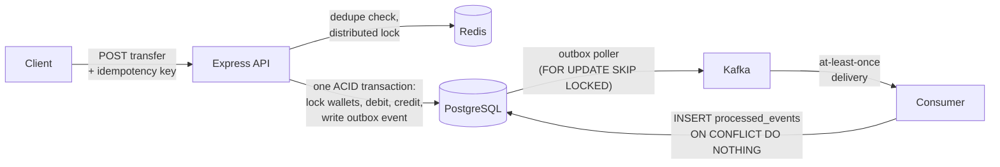

<!-- banner.svg and journey.svg must sit in the repo root, next to README.md. The ?v=1 on their URLs busts the image cache: bump it if you replace a file. -->

  

<!-- Animated line: edit the lines= part of the URL. Use + for spaces and ; between lines. -->

  

<!-- LinkedIn: your portfolio links to linkedin.com/in/gutti-narendra-8b817b357 while this uses linkedin.com/in/gnarendra9100. Keep whichever URL is correct (here and in the footer). -->

  
  
  

  

## 👨‍💻 About

Backend developer building APIs and event-driven services designed to stay correct under concurrency and failure.

- 🎓 **Education:** B.Tech Computer Science and Engineering (Data Science)
- 🧪 **Quality engineering:** testing, debugging, reliability, and edge cases, with automated test suites in node:test and pytest
- 🧩 **Problem solving:** 300+ problems solved on LeetCode
- 🏆 **Hackathon:** Top 5 at Dev Crafts Hackathon

> I like building things, breaking them on purpose, and figuring out why they broke.

## 🚀 Featured projects

### 💳 Distributed Payment & Wallet System

Payment and wallet backend focused on correctness under concurrency and partial failure, implemented two ways: a single service using the transactional outbox pattern, and event-driven microservices coordinated by a saga.

- 🔒 **Idempotent transfers:** SHA-256 payload fingerprinting with Redis and PostgreSQL checks, so a reused key with different details is rejected
- 🛡️ **Safe concurrency:** ACID transactions with ordered row-level locks to prevent deadlocks
- 📨 **Reliable events:** transactional outbox publishing to Kafka with retries, a dead-letter state, and idempotent consumers
- 🔄 **Distributed transactions:** saga orchestration with compensating actions across wallet, payment, and orchestrator services
- ✅ **Tested:** 27 unit and integration tests covering idempotency, refunds, auth guards, and duplicate event delivery

<b>View architecture</b>

📂 **Source:** [distributed-payment-wallet](https://github.com/gnarendra9014-user/distributed-payment-wallet) (outbox pattern) and [payment-wallet-system](https://github.com/gnarendra9014-user/payment-wallet-system) (saga microservices)

### ⚡ Scalable Job Scheduler

Job scheduling platform built with Node.js and BullMQ that runs asynchronous work through distributed queues and background worker pools.

- 📋 **Job types:** concurrent, delayed, and recurring (cron-style) jobs
- 🔁 **Failure handling:** automated retries with exponential backoff and a dead-letter queue
- 📦 **Deployment:** Docker and Kubernetes for horizontal scaling and fault tolerance

<!-- Add the repository link here once the scheduler is public: 📂 **Source:** [repo-name](https://github.com/gnarendra9014-user/repo-name) -->

## 🛠️ Tech stack

<table>
  <tr>
    <td><b>💻 Languages</b></td>
    <td></td>
  </tr>
  <tr>
    <td><b>⚙️ Backend &amp; databases</b></td>
    <td></td>
  </tr>
  <tr>
    <td><b>☁️ Systems &amp; cloud</b></td>
    <td></td>
  </tr>
  <tr>
    <td><b>🌐 Web</b></td>
    <td></td>
  </tr>
  <tr>
    <td><b>🧰 Tools &amp; platforms</b></td>
    <td></td>
  </tr>
</table>

## 📈 Developer journey

  

<b>What I built at each stage</b>

 

<table>
  <tr>
    <td align="center">1️⃣</td>
    <td></td>
    <td><b>Foundations: Python and C++</b> Programming fundamentals, data structures, and algorithms. Built <a href="https://github.com/gnarendra9014-user/PCL">Road Safety AI</a> (YOLOv8 and OpenCV, served with FastAPI, tested with pytest) and <a href="https://github.com/gnarendra9014-user/Map-Routing">Map Router</a>, a pathfinding visualizer comparing Dijkstra, A*, and Contraction Hierarchies.</td>
  </tr>
  <tr>
    <td align="center">2️⃣</td>
    <td></td>
    <td><b>The web: JavaScript and TypeScript</b> Core JavaScript and TypeScript, applied in <a href="https://github.com/gnarendra9014-user/resume-coach">resume-coach</a>, a Next.js app using Tailwind, Supabase auth, and the Groq API.</td>
  </tr>
  <tr>
    <td align="center">3️⃣</td>
    <td></td>
    <td><b>Backend: Node.js and Express</b> Built <a href="https://github.com/gnarendra9014-user/ecommerce-backend">ecommerce-backend</a>, a REST API with JWT authentication, request validation, cart and order flows, Razorpay payments, and Swagger docs.</td>
  </tr>
  <tr>
    <td align="center">4️⃣</td>
    <td></td>
    <td><b>Databases: PostgreSQL and Redis</b> Relational modelling and ACID transactions in PostgreSQL, with Redis for caching and distributed locks.</td>
  </tr>
  <tr>
    <td align="center">5️⃣</td>
    <td></td>
    <td><b>Event streaming: Kafka</b> Asynchronous, event-driven design with a transactional outbox, at-least-once delivery, and idempotent consumers in <a href="https://github.com/gnarendra9014-user/distributed-payment-wallet">distributed-payment-wallet</a>.</td>
  </tr>
  <tr>
    <td align="center">6️⃣</td>
    <td></td>
    <td><b>Distributed systems</b> Saga orchestration with compensating actions across three services in <a href="https://github.com/gnarendra9014-user/payment-wallet-system">payment-wallet-system</a>, plus a BullMQ job scheduler with exponential backoff and dead-letter queues, deployed with Docker and Kubernetes.</td>
  </tr>
  <tr>
    <td align="center">🔭</td>
    <td></td>
    <td><b>Now: system design and reliability</b> Scalable backend architecture, fault tolerance, and cloud deployment.</td>
  </tr>
</table>

## 📊 GitHub activity

  <picture>
    <source media="(prefers-color-scheme: dark)" srcset="https://streak-stats.demolab.com/?user=gnarendra9014-user&background=0D1117&border=30363D&stroke=30363D&ring=3FB950&fire=3FB950&currStreakNum=E6EDF3&sideNums=E6EDF3&currStreakLabel=3FB950&sideLabels=8B949E&dates=8B949E&border_radius=6" />
    
  </picture>

  <picture>
    <source media="(prefers-color-scheme: dark)" srcset="https://raw.githubusercontent.com/gnarendra9014-user/gnarendra9014-user/output/github-contribution-grid-snake-dark.svg" />
    
  </picture>

## 📫 Let's connect

  Open to software engineering, backend, and QA roles. 
  Happy to talk backend engineering, testing, and distributed systems.

  
  
  

Code. Debug. Learn. Repeat.

